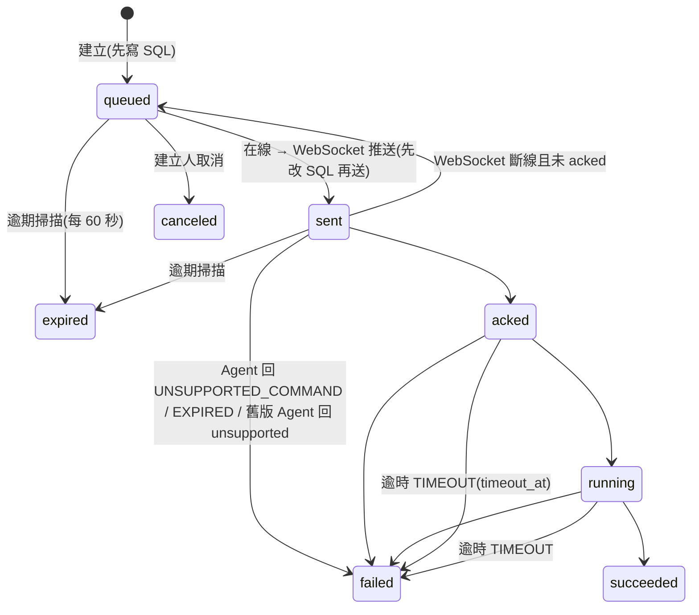

# P4 指令通道設計

> 草案 2026-10-15,分支 `feature/p4-command`(從 `gitlab/develop` e926a2f 開，已合併 316ef31 v0.2.1)。依據:PLATFORM-PLAN §4.4、§5、§6、§8 P4 列;指南 ENDPOINT-AGENT-GUIDE §8.2–§8.5、§5.6、§6.5。
> **2026-10-15 需求方確認**:§7 第 1–3 項照建議(新增 `command_update_ack`、`ita.command_file` 一起建、admin 路徑延到 P6);migration 0003 經需求方看過後由 Claude 套用到 `giganexus_It_Agent_test`。P4-1 已實作,契約以 `docs/contracts/` 為準、資料表以 `ItAgentBack/docs/DB_SCHEMA.md` 為準。
> **P4-2(2026-10-15,分支 `feature/p4-diagnose`)**:§8 設計經需求方確認(「同意方案」)後實作。

## 0. 分批

| 批 | 內容 | 需要同意 |
| --- | --- | --- |
| **P4-1(本次)** | migration `0003_command.sql`;契約 `command` / `command_update` / `command_update_ack` / `prepare_shutdown` 與 `command-kinds.md`;ItAgentBack `command-dispatcher` 與 **basic** 指令 API;Agent 執行器 + `inventory.collect`、`agent.restart`、`message.show`(Agent 0.3.0,自 0.2.1 往上) | migration 套用到 `giganexus_It_Agent_test` 前先問 |
| P4-2(§8) | `agent.diagnose`、`logs.collect`(診斷檔上傳 HTTPS、下載 API)、`agent.log_level`(Agent 0.4.0) | 新增 Rust 相依 `zip`(已同意) |
| P4-3 | GigaItApp 指令按鈕、「指令紀錄」Tab;`gateway-rbac.yaml` 綁 `endpoint.command.basic`(OpenAPI 註冊後) | **GigaItApp、BFF 權限:動手前另外確認** |

P4 完成標準(§8)要 P4-1~3 全部做完才達成;P4-1 結束時能以 curl / 測試對本機與測試區驗證「queued → succeeded、離線補送、過期不執行、離線完成的結果補回、稽核欄位」。

## 1. 資料表(`0003_command.sql`,SQL Server 2012)

### `ita.command_batch` — 多台同一指令

| 欄位 | 型別 | 說明 |
| --- | --- | --- |
| `id` | BIGINT IDENTITY PK | |
| `batch_id` | UNIQUEIDENTIFIER UQ | 對外 `batchId` |
| `kind` / `level` | VARCHAR(64) / VARCHAR(8) | `level` CHECK `basic`/`admin` |
| `params` | NVARCHAR(4000) | JSON;規則見 §1.3 |
| `target_count` | INT | 台數 |
| `max_concurrent` | INT | 同時 `sent`/`acked`/`running` 上限,預設 20(指南 §8.4) |
| `requires_approval` / `approved_by_emp` / `approved_by_name` / `approved_at` | BIT / NVARCHAR(64) / NVARCHAR(100) / DATETIME2(3) | 第二人核可(B1);**欄位先建,邏輯在 P7**(P4 只有 basic,不需核可) |
| `idempotency_key` | VARCHAR(128) NULL | 與 `created_by_emp` 組成篩選唯一索引 |
| `created_by_emp` / `created_by_name` / `request_id` / `created_at` | | 稽核(指南 §8.5) |

### `ita.command` — 一筆 = 一台電腦一個動作

| 欄位 | 型別 | 說明 |
| --- | --- | --- |
| `id` | BIGINT IDENTITY PK | |
| `command_id` | UNIQUEIDENTIFIER UQ | 對外 `commandId`;Agent 以此去重 |
| `batch_ref` | BIGINT NULL FK | |
| `device_ref` | INT FK | |
| `cert_dn` | NVARCHAR(450) | 建立當下的 DN(稽核;裝置之後換憑證也查得到當時對象) |
| `kind` / `level` / `params` | | 同上 |
| `state` | VARCHAR(16) | CHECK `queued`/`sent`/`acked`/`running`/`succeeded`/`failed`/`canceled`/`expired` |
| `progress` | TINYINT NULL | 0–100 |
| `result_summary` | NVARCHAR(4000) NULL | Agent 的 `result`(JSON,超過上限存 `{"truncated":true,"size":n}`) |
| `error_code` / `error_message` | VARCHAR(64) / NVARCHAR(1000) | |
| `expires_at` | DATETIME2(3) | 有效期限(未送達前有效;§2) |
| `timeout_at` | DATETIME2(3) NULL | `acked` 時設定 = acked + 類型逾時 |
| `send_count` | INT | 推送次數(重送觀察用) |
| `idempotency_key` | VARCHAR(128) NULL | |
| `created_by_emp` / `created_by_name` / `request_id` | | 稽核;`emp`、`name` 來自內部 Token |
| `created_at` / `sent_at` / `acked_at` / `started_at` / `finished_at` / `updated_at` | DATETIME2(3) | 各階段時間 |
| `row_ver` | ROWVERSION | |

索引:`(device_ref, state, created_at)`(重連補送、裝置指令紀錄)、`(state, expires_at)`(逾期掃描)、`batch_ref`、`created_at`(全部指令紀錄)、篩選唯一 `(created_by_emp, idempotency_key) WHERE idempotency_key IS NOT NULL`。

### `ita.command_file` — 診斷檔案索引(A4)

PLATFORM-PLAN §5.2 把它列在 0003,**建議表一起建、程式在 P4-2**(避免 0004 之後的編號全部後移):`id`、`file_id` UQ、`command_ref` FK、`file_name`、`size_bytes`、`sha256`、`storage_path`、`created_at`、`expires_at`(保存 14–30 天,B5)。

### 1.3 參數與遮罩

- 指令參數**不得含機密**(密碼、Token):需要機密的動作由主機自己持有(例如 NAS 帳密只在後端,D10),`command-kinds.md` 每個類型列出參數,不列機密欄位。
- 因此 `params` 原樣保存(重連補送要用),不另做遮罩(實作時移除了原本預留的遮罩欄位清單:遮罩後就無法重送,與「不含機密」的規則重複)。

## 2. 狀態機(主機端強制)

- **只能往前走**:`queued(0) < sent(1) < acked(2) < running(3) < 終態(4)`;收到較舊或重複的 `command_update` 只回 ack、不改資料。終態(`succeeded`/`failed`/`canceled`/`expired`)不可再變。
- **裝置相符**:`command_update` 只接受屬於這條 WebSocket 裝置的 `command_id`;不是的記 warn 並回 `command_update_ack { accepted: false }`(防止一台電腦改別台的結果)。
- **送出**:`UPDATE ... SET state='sent', sent_at, send_count+=1 WHERE state='queued'` 成功才 `socket.send`;信封 `id` = `command_id`(舊版 Agent 回 `unsupported` 時沿用此 id,主機據此設為 `failed UNSUPPORTED_COMMAND`)。
- **重連補送**:收到 `hello` 回 `hello_ack` 之後,依 `created_at` 送出該裝置所有未逾期的 `queued`(受批次上限限制)。
- **斷線**:該裝置所有 `sent` 改回 `queued`(之後重送,Agent 去重);`acked` / `running` 不動,等 Agent 重連後補回結果,或逾時。
- **逾期 vs 逾時**:`expires_at` 只管「尚未被 Agent 確認收到」(`queued`/`sent`);一旦 `acked`,改看類型的執行逾時 `timeout_at`。Agent 收到時也檢查 `expires_at`(以 `hello_ack.clock_skew_ms` 換算主機時間),過期回 `failed EXPIRED`、不執行。
- **取消**:只能取消**自己建立**(`created_by_emp` = Token 的 `emp`)且仍是 `queued` 的指令(指南 §8.3「尚未送出」)。
- **批次限流**:批次內 `sent`+`acked`+`running` 達 `max_concurrent` 時,其餘留在 `queued`;有一筆進終態就補送下一筆。
- **單一實例**:在線連線表在本行程(指南 §8.4);多實例(Redis pub/sub)另議,不在 P4。
- **SQL 失敗**:建立指令回 503;`command_update` 寫不進 SQL 就不回 ack,Agent 留在本機稍後重送。

## 3. 契約變更(`ws-envelope.schema.json` 只新增)

| type | 方向 | body |
| --- | --- | --- |
| `command` | Server → Agent | `command_id`(uuid)、`kind`、`params`(object)、`expires_at`(date-time)、`issued_by`(工號,Agent 寫本機日誌)、`issued_at` |
| `command_update` | Agent → Server | `command_id`、`state`(`acked`/`running`/`succeeded`/`failed`)、`progress`(0–100,選填)、`result`(object,選填,序列化 ≤ 4,000 字元;大資料走 HTTPS)、`error_code`、`error_message`、`occurred_at`(端點時間) |
| `command_update_ack` **(新增,指南沒有)** | Server → Agent | `command_id`、`state`、`accepted`(boolean)。**理由**:Agent 的結果要「先寫本機,主機確認才刪」(§4.4);沒有回覆就無法判斷送到沒 |
| `prepare_shutdown` | Server → Agent | `reason`(`server_restart` / `upgrade` / …)、`reconnect_after_sec`(選填)。Agent:送完待送的 `command_update`、以 1000 關閉、隨機 0–30 秒(或指定秒數)後重連。P4 由主機關閉時送出(取代目前直接 1001);P5/P6 Watchdog 升級沿用 |

`command-kinds.md`(新):每個類型的等級、`params`、`result`、預設有效期限、執行逾時、是否「會改變系統」(Agent 串行)、錯誤代碼。第一批:

| kind | 等級 | params | result | 有效 / 逾時 | 串行 |
| --- | --- | --- | --- | --- | --- |
| `inventory.collect` | basic | 無 | `agent_seq`、`result`(`stored`/`unchanged`/`archived`) | 1 小時 / 10 分鐘 | 否 |
| `agent.restart` | basic | 無 | `restarted_at`、`previous_pid` | 1 小時 / 5 分鐘 | 是 |
| `message.show` | basic | `title`(≤64,選填,預設「IT 部門通知」)、`text`(1–1000)、`timeout_sec`(0–3600,0 = 不自動關閉) | `session_id`、`shown_via`(`wts`;P8 起可能為 `desktop`) | 1 小時 / 2 分鐘 | 否 |

建立時可帶 `expiresInSec`(60–86400)覆寫有效期限。錯誤代碼:`UNSUPPORTED_COMMAND`、`EXPIRED`、`TIMEOUT`(主機判定)、`INVALID_PARAMS`、`NO_ACTIVE_SESSION`(沒有人登入)、`NOT_RUNNING_AS_SERVICE`(前景模式不能 restart)、`EXECUTION_FAILED`。

## 4. ItAgentBack

### 4.1 模組

- `src/commands/kinds.ts`:類型表(等級、params JSON Schema、有效 / 逾時、遮罩欄位)。
- `src/services/command-dispatcher.ts`:建立(單台 / 批次、冪等)、推送、`command_update`、重連補送、斷線退回、每 60 秒逾期與逾時掃描、批次補送、取消、查詢。DeviceService 只在 `connected` / `hello` / `disconnected` / 新訊息類型時呼叫它;連線表仍由 DeviceService 擁有,dispatcher 透過 `send(deviceId, envelope)` 介面推送。
- `src/stores/`:`CommandStore` 介面 + `sql-store.ts` 實作;測試用假實作放 `test/helpers.ts`。
- `src/routes/commands.ts`:管理 API。

### 4.2 管理 API(`:51240`,對外 `/api/endpoint/*`,BFF 依 `x-permission` 檢查)

| 方法 | 路徑 | `x-permission` | 說明 |
| --- | --- | --- | --- |
| POST | `/v1/devices/{deviceId}/basic-commands` | `endpoint.command.basic` | `{ kind, params?, expiresInSec? }`,`Idempotency-Key` 選填 → `202 { commandId, state }`;`x-audit-level: meta` |
| POST | `/v1/batches/basic-commands` | `endpoint.command.basic` | `{ deviceIds[1..200], kind, params?, expiresInSec? }` → `202 { batchId, commands: [{ deviceId, commandId, state }] }` |
| POST | `/v1/commands/{commandId}/cancel` | `endpoint.command.basic` | 只能取消自己建立、`queued` 的 |
| GET | `/v1/commands/{commandId}` | `endpoint.device.read` | 狀態、結果、稽核欄位(前端執行中每 2 秒輪詢) |
| GET | `/v1/devices/{deviceId}/commands` | `endpoint.device.read` | 該電腦的指令紀錄(新到舊,`limit` ≤ 100、`before` 游標) |
| GET | `/v1/commands` | `endpoint.device.read` | 全部指令(篩選 `state`、`kind`、`batchId`;GigaItApp「指令紀錄」頁) |
| GET | `/v1/batches/{batchId}` | `endpoint.device.read` | 批次與各台狀態統計 |

- **admin 路徑(`/admin-commands`)在 P6 有第一個 admin 類型時才加**,不先開空路徑;`basic-commands` 收到非 basic 類型 → `400 ENDPOINT_COMMAND_LEVEL_MISMATCH`(指南 §8.3),不認得的類型 → `400 ITA_COMMAND_KIND_UNKNOWN`,參數不符 → `400 VALIDATION_FAILED`。
- 停用 / 退役裝置 → `409 ITA_DEVICE_NOT_ACTIVE`;取消別人的 → `403 ITA_COMMAND_NOT_OWNER`;已送出 → `409 ITA_COMMAND_NOT_CANCELABLE`;找不到 → `404 ITA_COMMAND_NOT_FOUND`。
- 冪等:同一工號 + 同一 `Idempotency-Key` 回傳既有的那筆(同樣 202)。
- 資料範圍(`cos`,指南 E6)與裝置清單相同,尚未過濾。

## 5. Agent(`rustit-agent` 0.3.0)

- `src/command.rs`:收到 `command` → 查本機 `command_log`(去重,重開機後仍有效)→ 已有:重送最後狀態、不重跑;沒有:檢查 `expires_at` → 不認得的 kind 回 `failed UNSUPPORTED_COMMAND` → 寫本機 → `acked` → `running` → 執行 → 結果先寫本機 → `command_update`。
- 本機 store 新表 `command_log(command_id PK, kind, state, received_at, updated_at, update_json BLOB 加密, reported INTEGER)`;`command_update_ack` 收到才標記 `reported`;重連(收到 `hello_ack`)後重送未確認的最後狀態;已回報的保留 7 天(大於最長有效期限 1 天,才能去重)。
- 並行:`agent.restart`(之後 `software.*`、`system.reboot`、`agent.upgrade`)取得同一把串行鎖;查詢類並行。
- `inventory.collect`:經 channel 叫資產迴圈立即蒐集並送出,等 `POST /inventory` 的結果回報(斷線時結果留本機,補回)。
- `agent.restart`:記錄「重啟中」到本機 → 回 `running` → 正常收尾後以服務專屬結束代碼停止 → SCM 失敗復原 10 秒後啟動 → 啟動時看到紀錄回 `succeeded`。前景模式回 `failed NOT_RUNNING_AS_SERVICE`。注意:失敗復原計數 1 天內第 2、3 次分別 30、60 秒才重啟。
- `message.show`:P8 使用者端程式尚未存在,一律 `WTSSendMessageW` 送到主控台工作階段(`WTSGetActiveConsoleSessionId`,不等待使用者按下,`bWait = FALSE`);沒有登入者回 `NO_ACTIVE_SESSION`。需 `windows-sys` 加 `Win32_System_RemoteDesktop` feature。
- `prepare_shutdown`:見 §3。

## 6. 測試與驗證

- ItAgentBack:契約測試(新範例 `ws-command*.sample.json`、`ws-prepare-shutdown.sample.json`)、dispatcher 單元測試(狀態只能前進、裝置不符、斷線退回、補送順序、逾期 / 逾時、批次限流、冪等、取消權限)、管理 API 測試、`test:int` 的 SQL store(`giganexus_It_Agent_poc_test`)。
- Agent:契約測試、`command_log` 去重與重送、過期不執行、不認得的 kind。
- 端到端:本機 `npm run dev`(dev,`DEV_SKIP_TOKEN`)+ 自己電腦前景 Agent:`inventory.collect`、`message.show`(會在自己的螢幕跳訊息)、拔線後下指令 → 重連補送、`expiresInSec=60` 離線過期;`agent.restart` 用開發安裝的服務測。**要先套 0003 到 `giganexus_It_Agent_test`(開發與測試區共用,需同意)**。

## 6.1 審查後的修正(code-reviewer、security-auditor 子代理,2026-10-15)

- 卡在 `sent`:被新連線取代 / 半開的舊連線不經斷線處理 → `hello` 時先把 `sent` 改回 `queued` 再補送;斷線先移出連線表再改回 `queued`;對非開啟狀態的 WebSocket 送出視為失敗。
- Agent 的 ack 對應:改以信封 id 對應(原本以 command_id 只記最後狀態,前一則 ack 會把後一個狀態誤標為已回報);主機沒回 ack 時同一連線 60 秒後重送;無法解密的待送狀態記錄後不再重送。
- `message.show` 防濫用:標題固定前綴、內文附發送人、拒絕控制 / 雙向文字字元、最多 30 行;每台未結束的 `message.show` ≤ 3、`agent.restart` ≤ 1(`409 ITA_COMMAND_LIMIT`)。
- 冪等鍵用在不同電腦 / 類型回 `422 ITA_IDEMPOTENCY_KEY_REUSED`;批次補送在本行程內依批次串行(上限不超量);`onHello` 補送不擋心跳;關閉服務時 `prepare_shutdown` 後等 1 秒再關閉;migrator 計算 checksum 前統一換行(Windows autocrlf)。
- **未處理(列為後續)**:WebSocket 每條連線的訊息速率上限(端點憑證被盜時的 DoS);`result` 依類型以 schema 限制欄位、GigaItApp 只以文字顯示結果(P4-3 實作時遵守,不用 `v-html`);批次上限在多實例時改為 SQL 原子條件(目前單一實例)。`message.show` 屬 basic 依 PLATFORM-PLAN §10 差異 2,指南修訂時一併確認。

## 7. 要你決定的事

1. `command_update_ack`(指南沒有的新類型)是否同意加入?(建議:同意;另一個做法是結果改走 HTTPS `POST /agent/v1/commands/{id}/result`,但指南已定 `command_update` 走 WebSocket)
2. `ita.command_file` 是否在 0003 一起建?(建議:是)
3. admin 路徑延到 P6 才加?(建議:是)
4. 0003 寫好後,由你在開發機執行 `npm run db:migrate` 套到 `giganexus_It_Agent_test`,還是我來執行?(HANDOFF §4:migration 由開發者電腦套用;寫入測試區前要先問)
5. 指南 §8.3、§8.4 的修訂(`message.show` 已列在 PLATFORM-PLAN §10 差異 2;另加 `command_update_ack`、`prepare_shutdown` body)— P4-1 完成後一併提給 Gateway repo,屆時再確認。

## 8. P4-2:遠端診斷(A4)

> 需求方 2026-10-15 確認:三個類型照下表、新增 Rust 相依 `zip`、附檔放 Docker volume 保存 14 天、下載權限 `endpoint.device.read`。類型的完整定義在 `docs/contracts/command-kinds.md`。

| kind | 有效 / 逾時 | 每台上限 | 內容 |
| --- | --- | --- | --- |
| `agent.diagnose` | 1 小時 / 3 分鐘 | 1 | 無參數;檢查 `gateway`(`GET /healthz`)、`dns`(AD 網域)、`clock`、`cert`(到期日)、`disk`(系統磁碟)、`wmi`(`Win32_ComputerSystem`,同時取得網域)、`store`,各項 `ok` / `warn` / `fail` / `skipped`,結果在 `result` |
| `logs.collect` | 1 小時 / 15 分鐘 | 1 | `days` 1–14(預設 3);日誌遮罩後壓成 zip(20 MB,超過捨棄最舊的日期)→ 上傳附檔;`NO_LOGS`、`UPLOAD_FAILED` |
| `agent.log_level` | 1 小時 / 1 分鐘 | 1 | `level` debug / trace / default、`duration_min` 5–1440(預設 60);本機 kv 保存,重啟後仍有效直到到期,每分鐘檢查到期 |

### 8.1 附檔上傳與存放

- `POST /agent/v1/commands/{commandId}/files`(`:9443` → `:51241`,裝置憑證):本體為 zip 原始位元組、必須帶 `Content-Length`(否則 `411 ITA_LENGTH_REQUIRED`)、標頭 `x-file-sha256`。只接受屬於此裝置、`kind` 允許附檔(`kinds.ts` 的 `files`)、狀態 `acked` / `running` 的指令;串流寫暫存檔並計算 SHA-256 與大小(20 MB),相符才搬到 `<COMMAND_FILES_DIR>/<yyyy>/<MM>/<file_id>.zip`,再寫 `ita.command_file`(SQL 失敗刪檔、503)。每筆指令一個檔,重送相同內容回同一個 `file_id`;同一指令同時只處理一個上傳。檔名與路徑由主機產生。
- 存放:容器 `/data/command-files`,Docker volume `ita_command_files`(`deploy/docker-compose.yml`;Dockerfile 預先建立目錄給 `node`);dev 預設 `ItAgentBack/data/dev/command-files`(已在 .gitignore)。不放 Mongo GridFS(Mongo 只放可重建的資料)。
- 保存:`COMMAND_FILE_KEEP_DAYS` 14–30,預設 14(B5);每小時刪除到期檔案與索引列,並清除超過 1 小時的上傳暫存檔;`ita.command` 紀錄與 `result` 保留。
- Gateway 不用改:`:9443` 的 `client_max_body_size 0`(上限由本服務決定),BFF 代理以串流回傳二進位。

### 8.2 下載

- `GET /v1/commands/{commandId}/files/{fileId}`(`endpoint.device.read`、`x-audit-level: meta`):`Content-Disposition: attachment`(`<電腦名稱>-logs-<UTC 時間>Z.zip`,只留英數與 `-` `_`)、`X-Content-Type-Options: nosniff`、`Cache-Control: no-store`、`x-file-sha256`。`fileId` 不屬於此指令 `404 ITA_COMMAND_FILE_NOT_FOUND`;過期或檔案已不在 `410 ITA_COMMAND_FILE_EXPIRED`。
- `GET /v1/commands/{commandId}` 回應加 `files`(`fileId`、`fileName`、`sizeBytes`、`sha256`、`createdAt`、`expiresAt`、`expired`)。
- 日誌可能含電腦名稱、登入帳號與 IP;下載記錄稽核。GigaItApp 下載按鈕屬 P4-3。

### 8.3 日誌不含私鑰與 Token

- 日誌本來就不可記錄私鑰、Token(`AGENT.md` §7.1);`logs.collect` 再逐行遮罩:`-----BEGIN … PRIVATE KEY-----` 整段、`Bearer` / `Basic` 之後的值、鍵 `token` / `password` / `passwd` / `pwd` / `secret` / `api_key` / `api-key` / `apikey` 接 `=` 或 `:`(前後可有空白、JSON 引號)的值,不分大小寫。
- `agent.log_level` 調到 trace 時,第三方套件(HTTP、TLS、WebSocket)仍只記 warn 以上(`rustit_common::logging`),不會記下標頭或內容。
- `agent.diagnose` 的 `cert` 只讀憑證到期日,不讀私鑰、不回傳憑證內容。

### 8.4 審查後的修正(code-reviewer、security-auditor 子代理,2026-10-15)

- 遮罩補 `key: value`、`key = value`、JSON `"key":"value"`、`Basic`、`passwd` / `pwd` / `api_key`;引號未閉合時保留換行。
- 上傳必須帶 `Content-Length`(411):提早拒絕或重送相同內容時丟棄的本體受宣告長度限制;提早拒絕時丟棄未讀本體。
- Agent 上傳:404、413、409 `ITA_COMMAND_NOT_RUNNING` 不重試(只有 409 `ITA_COMMAND_FILE_EXISTS` 與網路 / 5xx 重試);上傳逾時依大小放寬(每秒 100 KB 估算,至少 60 秒);最新一天壓縮後就超過上限時失敗,不上傳空 zip;設定檔日誌等級以行程第一次啟動時為準(`OnceLock`)。
- **未處理(列為後續)**:慢速上傳佔住回報併發名額(上傳專用逾時或併發上限,Nginx 端 body 逾時屬 Gateway repo);`ita.command_file.command_ref` 唯一索引(目前以單一實例的程序內鎖保證一指令一檔,多實例前需 migration);附檔目錄總量 / 剩餘空間檢查(507)與磁碟告警;下載權限是否另設 `endpoint.command.file.read`(需求方已定 `endpoint.device.read`,上線前可再檢討);`agent.log_level` 套用與到期恢復的單元測試(需 Shared 測試替身)。
