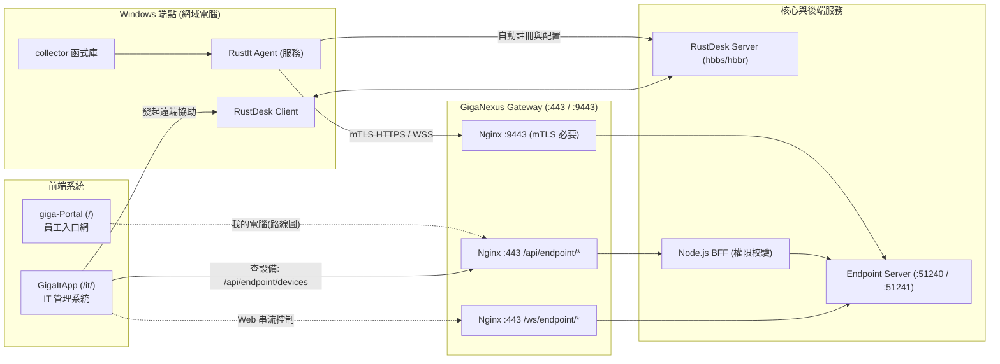

# 專案地圖 — RustIt (企業端點資產管理與控管平台)

> **最後更新**：2026-10-20(P6-2 Watchdog 升級 Agent:Watchdog 0.2.0 `upgrade/`(`mod.rs` 狀態機、`swap.rs` 正式環境、`download.rs` 續傳)、`watchdog.db` `upgrade` 表、上報 `upgrade` / 回應 `target`、維護中;common `authenticode.rs`、`version.rs`、`winfile.rs`、`transport.rs` `download`(不跟隨重新導向)、`config.rs` `[upgrade] trusted_signers`;Agent 0.7.0 管道 `prepare_shutdown`、`status.upgrade_requested`、指令 `agent.upgrade`、壞版本 feature;兩支 exe 的 `build.rs` 版本資源;契約 `pipe.schema.json` PrepareShutdown / Ack;installer `new-test-signing-cert.ps1`、`build-test-release.ps1`、MSI `-TrustedSigners`)。2026-10-20(P6-1 版本登錄與發佈環:migration 0007 `ita.agent_release`、`ita.release_ring`、`ita.device_upgrade`、`ita.device.ring`;ItAgentBack `release-service.ts`(目標版本選擇、進度、升級告警)、`release-files.ts`(版本檔目錄、Range)、`sql-release-store.ts`、`routes/releases.ts`、下載 `GET /agent/v1/releases/...`、Watchdog 上報回 `target`、`agent.upgrade` 指令(admin-commands 路由、kindHooks);契約 `watchdog.schema.json` `upgrade` / `target`、事件 `upgrade_*`;設定 `RELEASES_DIR`、`RELEASE_MAX_CONCURRENT`;設計 `P6-UPGRADE-DESIGN.md`)。2026-10-19(P5-2 Watchdog:新 crate `watchdog`(`rustit-watchdog` 0.1.0,看守狀態機 `monitor.rs`、上報 `report.rs`、本機紀錄 `outbox.rs`、服務 `service.rs`);common `scm.rs`(服務控制、失敗復原、服務 ACL)、`pipe.rs`(本機具名管道);Agent 0.6.0 `pipe.rs`(管道伺服端)、`guard.rs`(看守 Watchdog);監控 MSI 加 `GigaNexusWatchdog`;ItAgentBack `POST /agent/v1/watchdog/report`、`agent_tampered`;契約 `watchdog.schema.json`、`pipe.schema.json`)。2026-10-19(P5-1 監測:migration 0006 `ita.device_health`、`ita.device_alert`;ItAgentBack `change-detector.ts`(資產前後比對)、`alert-service.ts`(固定規則、每 5 分鐘掃描)、`sql-monitor-store.ts`、`routes/alerts.ts`、`GET /v1/devices/{id}/health`、清單 / 詳情加健康與告警;契約 `heartbeat.body.health`、`hello.cert_not_after`、`AgentSettings.health_enabled`、`agent_started.previous_exit`;Agent 0.5.0 心跳附健康摘要、上次結束原因;collector `health.rs`;設計 `P5-MONITOR-DESIGN.md`)。2026-10-16(E6 資料範圍依公司:migration 0005 `ita.device.company` / `company_source`;`services/scope.ts`(MgmtCtx)、`services/company.ts`、`routes/mgmt-ctx.ts`;管理 API 範圍外一律 404、`PUT /v1/devices/{id}/company`;設定 `ENDPOINT_SCOPE_ALL_ROLES`、`ENDPOINT_COMPANY_DOMAINS`;設計 `E6-COMPANY-SCOPE-DESIGN.md`)。2026-10-16(P3 資料呈現:migration 0004 `ita.device_software`;管理 API 清單分頁與篩選、`/events`、`/inventory.json`、`PUT /status`、`POST /merge`(`endpoint.command.admin`);設計 `P3-DATA-DESIGN.md`)。2026-10-15(P4-2 遠端診斷:Agent 0.4.0 `diagnose.rs`、`logs.rs`、`agent.log_level`;collector `system_volume`、`wmi_probe`;common `post_bytes`、`get_status`、`device_cert_not_after`;ItAgentBack `command-files.ts` 附檔上傳 / 下載 / 清除、volume `ita_command_files`;契約 `command-file.schema.json`)。2026-10-15(P4-1 指令通道:migration 0003、契約 command / command_update / command_update_ack / prepare_shutdown 與 `command-kinds.md`;ItAgentBack `command-dispatcher`、`routes/commands.ts`、`sql-command-store`;Agent `command.rs`(inventory.collect、agent.restart、message.show)、本機 `command_log`)。2026-10-14(P2 第二批 Agent:本機加密暫存 `store.rs` / `crypto.rs`、連線紀錄與 offline_period `conn.rs`、事件佇列 `events.rs`、USB 插拔 `usb.rs`、資產暫存與 `/sync` 補傳、429 依 Retry-After、主機下發設定;collector `removable_volumes`)。2026-10-14(P2 第一批主機端:契約 `event.schema.json`、hello / hello_ack 擴充、`/sync` 加 `skip`;ItAgentBack `/agent/v1/sync`、`/agent/v1/events`、429 ITA_BUSY、時鐘偏差與硬體指紋;migration 0002)。2026-10-14(P1 收尾:測試 VM 裝置憑證腳本 `installer/host2-issue-test-device-cert.sh`;`.cargo/config.toml` 靜態連結 C 執行階段)。2026-10-13(P1:監控 MSI(WiX v5,installer/);WMI 查詢逾時與蒐集背景優先權;Windows 憑證存放區 `store_issuer`(PoC 實測通過);抽出 `rustit-common`、移除 `native`;P1 第一批:Agent Windows 服務化 `service` / `install` / `uninstall`、檔案日誌;第二階段計畫 PLATFORM-PLAN v0.4:監控服務與使用者端程式分開、本機持久化;交接文件改寫;Demo 將改造為 desktop、native 將移除)。2026-10-07(M4 測試區接通:ItAgentBack 容器化與 CI 部署、Agent 經 Gateway :9443 回報)  
> **目前階段**：基本階段完成(Agent 前景執行 → `:9443` → ItAgentBack → GigaItApp 電腦清單,測試區運作);第二階段 [PLATFORM-PLAN.md](PLATFORM-PLAN.md) P0 定案、**P1 常駐完成**(服務化、監控 MSI,測試 VM 驗證通過);下一步 P2 本機持久化,P3、P8-1 可並行。  
> **上位規範**：全專案總圖 [PROJECT-MAP.md](../../PROJECT-MAP.md)、Gateway 規範 [giga-api-gateway-bff/docs/](../../giga-api-gateway-bff/docs/)。

---

## 1. 目錄結構

```
RustIt/
├─ README.md                        專案簡介與快速上手
├─ AGENT.md                         AI 協作準則(分工、部署區、Rust / Node.js 規則、修正紀錄)
├─ .gitlab-ci.yml                   check:itagentback(所有分支)、deploy-test(develop → 主機 2)
├─ .dockerignore                    ItAgentBack 映像檔建置 context 白名單
├─ docs/                            兩個子專案共用的文件(Gateway 等其他專案以 ../RustIt/docs/... 參照,不搬動)
│  ├─ PRD.md                        產品需求說明 (對標 IP-guard/SmartIT，四階段里程碑)
│  ├─ PLATFORM-PLAN.md              第二階段計畫:常駐服務、本機持久化、監測、指令、升級、軟體派送、使用者端程式(P0–P8)
│  ├─ INTEGRATION-PLAN.md           基本階段整合計畫(M0–M4 完成;M5 擴充為 PLATFORM-PLAN P2)
│  ├─ HANDOFF.md                    交接:目前狀態、下一步、已決定事項、需先同意的動作
│  ├─ contracts/                    Agent ↔ Server 資料契約(JSON Schema + 去識別化範例;兩端契約測試共用)
│  │  ├─ inventory.schema.json      POST /agent/v1/inventory
│  │  ├─ sync.schema.json           POST /agent/v1/sync(請求與回應;need / skip,P2)
│  │  ├─ event.schema.json          POST /agent/v1/events(offline_period、usb_*、agent_started、local_overflow;P2)
│  │  ├─ ws-envelope.schema.json    WebSocket 信封與 hello / heartbeat / heartbeat_ack
│  │  └─ examples/                  去識別化範例(假的使用者、序號、MAC、IP)
│  ├─ DevelopmentProcess/           修正紀錄(NewFeatures.md 等)
│  ├─ PROJECT-MAP.md                本文件 (專案結構、分層、流程、跨專案關係)
│  └─ decisions/                    重大技術架構決策
│     ├─ 0001-nginx-gateway-and-grpc.md Nginx 與通訊(Agent 改 HTTPS + WebSocket)
│     ├─ 0002-software-deployment.md 靜默軟體派送架構與安全機制
│     ├─ 0003-code-signing-pki.md   程式碼簽章與 PKI
│     └─ 0004-node-endpoint-server.md Endpoint Server 改用 Node.js(Rust 只做端點)
├─ RustAgent/                       Rust:端點電腦上的程式(Cargo workspace)
│  ├─ Cargo.toml                    Workspace 設定 (agent, collector, common, demo)
│  ├─ Cargo.lock
│  ├─ .cargo/config.toml            靜態連結 C 執行階段(+crt-static;乾淨的 Windows 不需安裝 VC++ 可轉散發套件)
│  ├─ dist/                         編譯成品存放目錄 (RustIt-Demo.exe, rustit-agent-test/ 等測試區 Agent 套件、msi/ 建置的 MSI,不進版控)
│  ├─ installer/                    監控 MSI(WiX v5):agent.wxs(GigaNexusAgent + GigaNexusWatchdog 兩個服務(P5-2)、程式與 ProgramData 目錄 ACL)、build-agent-msi.ps1(依部署區建置,設定在建置時寫入;P6-2 起 -TrustedSigners 寫入 [upgrade] trusted_signers)、new-test-signing-cert.ps1(測試簽章憑證,私鑰只在執行者電腦,P6-2)、build-test-release.ps1(建置並以測試憑證簽章升級檔 dist\releases\agent\<版本>\,可建壞版本,P6-2)、host2-issue-test-device-cert.sh(主機 2 以臨時 Agent CA 為測試 VM 簽 PFX,使用者執行)
│  ├─ docs/
│  │  ├─ ui-performance-comparison.md egui 原生 vs WebView2 效能實測比較(紀錄;native 已於 P1 移除)
│  │  └─ images/                    介面截圖
│  └─ crates/
│     ├─ collector/                 端點資料蒐集核心庫 (Library)
│     │  ├─ Cargo.toml              相依：wmi, winreg, sysinfo
│     │  └─ src/
│     │     ├─ lib.rs               對外統一介面 (ComputerInfo, collect() 進入點;蒐集期間進入背景模式)
│     │     ├─ background.rs        蒐集時執行緒進入 Windows 背景模式(低 CPU / I/O 優先權),結束時恢復
│     │     ├─ health.rs            健康摘要 HealthSampler(P5):CPU / 記憶體 / 最滿的固定磁碟 / 開機時間 / Agent RSS,只讀 sysinfo、不查 WMI;boot_time
│     │     ├─ registry.rs          登錄檔掃描 (已安裝軟體 Uninstall 機碼、USBSTOR、RustDesk)
│     │     └─ wmi_query.rs         WMI / CIM 查詢 (主機板 UUID、BIOS、CPU、磁碟、網卡、防毒);每項在獨立執行緒、逾時 15 秒,逾時後略過其餘 WMI 項目
│     ├─ demo/                      WebView2 概念驗證版 (Tauri;P8 改名為 desktop 作為使用者端程式,PLATFORM-PLAN §3.3)
│     │  ├─ src/ main.rs、deploy.rs Tauri 啟動與指令綁定;軟體派送模擬與雜湊校驗
│     │  └─ ui/                     前端 HTML/CSS/JS (Liquid Glass 玻璃擬態)
│     ├─ agent/                     端點 Agent:rustit-agent run(前景,開發)/ service(Windows 服務 GigaNexusAgent)/ install、uninstall(開發測試,正式用 MSI)
│     │  ├─ agent.dev.toml / agent.example.toml  本機直連 ItAgentBack / 測試區經 :9443 的設定範本
│     │  ├─ src/main.rs             只組裝:子指令、日誌、Ctrl+C
│     │  ├─ src/lib.rs              開啟本機暫存 → 延續 / 結束上次的離線期間、記 agent_started(上次結束原因 previous_exit,本機 kv last_exit;P5)→ 啟動隨機延遲 → 資產回報、WebSocket、事件、USB 四個工作;Shared(連線成功 / 失敗、停用狀態);run_blocking
│     │  ├─ src/service.rs          Windows 服務:SCM 進入點、狀態回報(啟動中 / 執行中 / 停止中)、每次啟動自行套用失敗復原 10/30/60 秒與服務 ACL(common::scm)、開發用 install / uninstall;agent.restart 以結束代碼 3 停止
│     │  ├─ build.rs                exe 版本資源(ProductVersion;RUSTIT_BUILD_VERSION 可覆寫,P6-2);features broken-exit / broken-no-ws 只供 VM 驗收
│     │  ├─ src/pipe.rs             本機管道伺服端(P5-2,服務模式):\\.\pipe\giganexus-agent-v1;get_status(含 upgrade_requested);prepare_shutdown(P6-2,只接受 Watchdog PID:停接指令、等執行中 60 秒、送完待送 20 秒、WebSocket 1000 關閉、5 分鐘沒被停止就恢復)
│     │  ├─ src/guard.rs            看守 Watchdog(P5-2,服務模式):每 60 秒;被停止 / 改啟動類型 → 恢復並記 watchdog_stopped,不存在 → watchdog_missing
│     │  ├─ src/command.rs          指令執行器(P4):command_id 去重、過期不執行、結果先寫本機;inventory.collect / agent.restart / message.show(WTSSendMessage)/ agent.log_level(本機 kv,到期恢復)/ agent.upgrade(P6-2,交給 Watchdog);升級中回 AGENT_UPGRADING
│     │  ├─ src/diagnose.rs         agent.diagnose(P4-2):gateway / dns / clock / cert / disk / wmi / store 檢查
│     │  ├─ src/logs.rs             logs.collect(P4-2):挑最近 N 天日誌、遮罩私鑰與 Token、zip(20 MB)
│     │  ├─ src/inventory.rs        蒐集 → 本機暫存 → 單份 POST /agent/v1/inventory、多份先 /sync(刪 skip、傳 need);停用時暫停蒐集;間隔依主機設定
│     │  ├─ src/store.rs            本機持久化 state\store.db(SQLite):kv、outbox_inventory / outbox_event(加密、上限)、conn_log(30 天)、command_log(指令去重與待回報狀態,加密,7 天)
│     │  ├─ src/crypto.rs           AES-256-GCM;金鑰以 DPAPI 執行帳號範圍(服務 = SYSTEM)+ 附加熵保護存 state\store.key(換電腦或一般使用者無法解開)
│     │  ├─ src/conn.rs             連線紀錄:失敗記 conn_log,恢復時(≥ 60 秒)寫 offline_period;服務重啟(10 分鐘內)延續同一段
│     │  ├─ src/events.rs           事件佇列(本機暫存)→ 批次 POST /agent/v1/events
│     │  ├─ src/usb.rs              每 10 秒比對可移除磁碟區 → usb_inserted / usb_removed
│     │  ├─ src/ws.rs               hello(端點時間、硬體指紋、憑證到期日)/ 30 秒 heartbeat(暫存數、健康摘要 health,P5)/ unsupported、hello_ack 主機設定寫入本機、斷線重連、停止時 close 1001;command 交給執行器、command_update 重送與 ack、prepare_shutdown
│     │  ├─ src/protocol.rs         Agent 契約型別(inventory、hello / hello_ack、sync、events、AgentSettings)、content_hash、hw_fingerprint、通道路徑與 User-Agent
│     │  └─ tests/contract.rs       以 docs/contracts 的 JSON Schema 驗證送出的 JSON
│     ├─ common/                    rustit-common:Agent 與 Watchdog 共用(PLATFORM-PLAN §3.1;P2 加入本機持久化、P5 加入具名管道)
│     │  ├─ src/config.rs           agent.toml 解析與檢查(http 只允許本機、dev 模擬憑證標頭、選用 log_level;[tls] 裝置憑證 PEM 檔或 store_issuer 二選一;[upgrade] trusted_signers,P6-2)
│     │  ├─ src/authenticode.rs     WinVerifyTrust + 簽章者 SHA-1 指紋;signer_allowed(主機清單 ∩ 本機清單)(P6-2;P6-3、P7 共用)
│     │  ├─ src/version.rs          版本號比較、下載路徑的元件 / 版本段 / 檔名檢查(P6-2)
│     │  ├─ src/winfile.rs          磁碟剩餘空間、exe ProductVersion(P6-2,Windows)
│     │  ├─ src/tls.rs              rustls ClientConfig(ring)、憑證來源 trait CertSource → 每次握手挑選:PemFiles、WindowsStore(LocalMachine\My + rustls-cng,私鑰留在 CNG);pick_device_cert 挑選規則;device_cert_not_after(診斷)
│     │  ├─ src/transport.rs        post_json(path)/ post_bytes(指令附檔)/ get_status(診斷)/ download(升級檔,Range 續傳、大小上限,P6-2)/ connect_ws(path);不跟隨重新導向,User-Agent 由呼叫端提供;錯誤分類(被拒 10 分鐘 / 429 依 Retry-After / 其他指數退避)、離線原因分類 reason()、底層錯誤串接
│     │  ├─ src/backoff.rs          1 秒起、上限 2 分鐘、±20%;啟動延遲
│     │  ├─ src/envelope.rs         WebSocket 信封 {v, type, id, body}
│     │  ├─ src/stop.rs             StopSignal / with_grace / wait(停止 30 秒、關機 5 秒收尾)
│     │  ├─ src/logging.rs          服務模式檔案日誌 <前綴>-YYYY-MM-DD.log:每日一檔、保留 14 天、單日 10 MB;第三方套件只收 warn 以上
│     │  ├─ src/paths.rs            %ProgramData%\GigaNexus\Agent(agent.toml、logs\)
│     │  ├─ src/scm.rs              服務控制(P5-2,Windows):查對方服務狀態 / PID / 結束代碼 / 啟動類型、啟動 / 停止 / 改回自動、結束行程、失敗復原、服務 ACL、關機與 MSI 執行中判斷
│     │  └─ src/pipe.rs             本機具名管道(P5-2,Windows):建立(SDDL 只允許 SYSTEM、Administrators)、一行 JSON 讀寫、用戶端與伺服端 PID
│     ├─ watchdog/                  rustit-watchdog(P5-2;0.2.0 P6-2):GigaNexusWatchdog 服務,看守 Agent 並自己經 :9443 上報;升級 Agent 與還原
│     │  ├─ build.rs                exe 版本資源(同 Agent)
│     │  ├─ src/main.rs             只組裝:run(前景,開發)/ service(SCM)
│     │  ├─ src/lib.rs              看守迴圈(每 30 秒 SCM + 管道 get_status,PID 比對防冒充;維護中暫停;upgrade_requested 重設失敗次數)、上報工作、升級工作(啟動時收尾)
│     │  ├─ src/monitor.rs          看守狀態機(純邏輯,AgentControl trait 注入):重啟原因、卡住、手動停止、當掉寬限、啟動類型、程式不見、啟動退避
│     │  ├─ src/report.rs           POST /agent/v1/watchdog/report:每 5 分鐘 + 有變化立即、退避;帶 upgrade 進度、回應 target.agent 交給升級工作(P6-2)
│     │  ├─ src/outbox.rs           state\watchdog.db(SQLite,不加密):待送事件(上限 1,000 筆)、upgrade 表(每元件一列,P6-2)
│     │  ├─ src/upgrade/mod.rs      升級狀態機(P6-2,UpgradeEnv trait 注入):檢查目標 → 下載 → SHA-256 / 簽章者 / 版本 → prepare_shutdown → 停止 → previous\ 備份 → .new 再驗 → 換上 → 2 分鐘健康檢查 → 失敗還原;中途重啟收尾;同版本失敗 2 次停止;tests.rs 假實作測試
│     │  ├─ src/upgrade/swap.rs     正式環境:SCM、管道、WinVerifyTrust、watchdog.db、維護中旗標
│     │  ├─ src/upgrade/download.rs cache\agent\{版本}\*.part 續傳(同一組 mTLS)
│     │  ├─ src/service.rs          Windows 服務 GigaNexusWatchdog:失敗復原與服務 ACL(common::scm)
│     │  └─ tests/contract.rs       上報請求符合 watchdog.schema.json(跨檔引用 event.schema.json)
│     └─ desktop/ (規劃,P8)         使用者端程式(由 demo 改名):托盤 + 視窗,我的電腦(電腦名稱、IP、登入人員)、公告通知、嵌入 Gateway 網頁應用;登入者身分,與監控服務分開
└─ ItAgentBack/                     Node.js(Fastify + TypeScript):Endpoint Server(ADR 0004);gateway.project = RustIt
   ├─ src/server.ts                 啟動兩個 listener:51240 管理 API、51241 Agent 通道
   ├─ src/config.ts                 部署區設定;dev 旁路(非 dev 設定即失敗)、test / prod 機密只收 _FILE;資料範圍 ENDPOINT_SCOPE_ALL_ROLES(test / prod 必填)、ENDPOINT_COMPANY_DOMAINS(E6)
   ├─ src/mgmt-app.ts               :51240 X-Internal-Token(驗完算出 req.scope,E6)、OpenAPI(x-permission)、setupGateway 監控與自動註冊
   ├─ src/routes/mgmt-ctx.ts        路由共用:由請求組 MgmtCtx(日誌、x-request-id、資料範圍)
   ├─ src/agent-app.ts              :51241 裝置身分 hook(x-client-cert-*、信任來源)、/agent/v1/inventory、/sync、/events、/agent/v1/commands/{id}/files、/agent/v1/watchdog/report、/agent/v1/releases/{component}/{version}/{file}(版本檔下載,P6)、/agent/v1/ws;回報同時處理上限 429 ITA_BUSY(A3)
   ├─ src/routes/devices.ts         GET /v1/devices(分頁、篩選;P5 加 health、openAlerts)、/v1/devices/{deviceId}、/events、/inventory.json、/health(健康走勢,P5)(endpoint.device.read);PUT /status、POST /merge、PUT /company(endpoint.command.admin;/company 另需全部公司角色,E6)
   ├─ src/routes/alerts.ts          告警 API(P5):GET /v1/alerts(endpoint.device.read)、POST /v1/alerts/{id}/resolve(endpoint.command.basic)
   ├─ src/routes/releases.ts        升級 API(P6):GET /v1/releases、/releases/files、/release-rings、/devices/{id}/upgrade(endpoint.device.read);POST /v1/releases、/{id}/publish、/{id}/revoke、PUT /release-rings/{ring}/{component}(endpoint.software.manage + 全部公司角色);PUT /devices/{id}/ring(endpoint.command.admin)
   ├─ src/routes/commands.ts        指令 API(P4):POST basic-commands / batches/basic-commands / cancel(endpoint.command.basic)、POST admin-commands(endpoint.command.admin,P6 agent.upgrade)、GET commands / batches、附檔下載 commands/{id}/files/{fileId}(endpoint.device.read)
   ├─ src/commands/kinds.ts         指令類型表:等級、有效期限 / 逾時、params schema(docs/contracts/command-kinds.md)
   ├─ src/services/command-files.ts 指令附檔(P4-2):Agent 上傳(SHA-256、20 MB、裝置與狀態檢查)→ COMMAND_FILES_DIR + ita.command_file;下載、每小時清除到期檔
   ├─ src/services/command-dispatcher.ts 指令狀態機:寫 SQL → 在線推送、重連補送、斷線退回、command_update / ack、逾期與逾時掃描、批次限流
   ├─ src/services/device-service.ts 寫入順序、hash 比對、降級、在線狀態、離線補傳比對、端點事件、時鐘偏差與硬體指紋、清單分頁、停用 / 退役、合併、軟體清單回填、所屬公司判定與指定、資料範圍(found() 單點查找);P5:心跳健康(Redis 在線資訊 + 每 5 分鐘落盤)、憑證到期日、資產比對事件(同一交易)、健康走勢
   ├─ src/services/change-detector.ts 資產前後比對(純函式,P5):軟體安裝 / 移除 / 更新、超過 50 項彙總、硬體元件變更
   ├─ src/services/alert-service.ts 告警(P5):evaluate 固定規則(純函式)、每 5 分鐘 sweep(開 / 更新 / 自動關閉、非 active 裝置關閉)、硬體變更開告警、清單與手動關閉
   ├─ src/services/release-service.ts 升級(P6):目標版本選擇(強制 > 所屬環、draft 只給 pilot、失敗 2 次、同時升級上限)、Watchdog 上報進度與 target、下載授權、環推進限制、upgrade_failed / version_mismatch、agent.upgrade 檢查與強制版本
   ├─ src/services/release-files.ts 版本檔目錄 RELEASES_DIR({component}/{version}/{檔名}、realpath 防穿越、SHA-256 快取、Range 解析)
   ├─ src/services/scope.ts         資料範圍(E6):scopeOf(cos / 全部公司角色)、inScope、MgmtCtx(管理方法型別上必帶 scope)
   ├─ src/services/company.ts       所屬公司自動判定:ENDPOINT_COMPANY_DOMAINS 解析、憑證 FQDN / 回報網域 → 公司(最長尾碼)
   ├─ src/stores/                   types.ts 介面;sql-store(mssql)、sql-command-store(指令)、sql-monitor-store(健康與告警,P5)、sql-release-store(版本、環、升級進度,P6;皆共用連線池)、mongo-store、redis-store
   ├─ src/contracts.ts              讀 ../docs/contracts(不複製)、型別
   ├─ src/db/migrator.ts、migrate.ts 手寫 SQL migration 與整合測試庫重建
   ├─ db/dba/                       建庫 T-SQL(DBA 以 sa 執行,AI 不執行)
   ├─ db/migrations/                0001_init.sql:ita.device、device_inventory、device_nic、device_event;0002_sync_event.sql:硬體指紋、時鐘偏差、退役、端點事件欄位(P2);0003_command.sql:ita.command、command_batch、command_file(P4);0004_device_software.sql:ita.device_software(P3);0005_device_company.sql:ita.device.company、company_source(E6);0006_monitor.sql:ita.device_health、device_alert(P5);0007_release.sql:ita.agent_release、release_ring、device_upgrade、device.ring(P6)
   ├─ deploy/docker-compose.dev.yml 本機 Mongo 7 / Redis 7(只綁 127.0.0.1)
   ├─ deploy/docker-compose.yml     測試區:endpoint-server(Gateway 網路,volume ita_command_files、版本檔目錄唯讀掛載 /srv/releases)+ ita-mongo / ita-redis(內部網路)
   ├─ deploy/host2-set-secrets.sh   主機 2 機密、臨時憑證、Gateway API Key、ita.env(需求方執行)
   ├─ Dockerfile                    建置 context 為 RustIt 根目錄(含 docs/contracts;根目錄 .dockerignore 白名單)
   ├─ test/                         單元與契約測試(記憶體儲存);test/int/ 整合測試(真實三種儲存)
   └─ docs/DB_SCHEMA.md             資料結構與寫入順序
```

---

## 2. 系統分層架構

| 層次 | 所屬元件 | 責任與主要功能 |
| :--- | :--- | :--- |
| **資料蒐集層 (Collector)** | `RustAgent/crates/collector` | 呼叫 Win32 API、WMI (`root\cimv2`) 與 Registry，產出結構化資產物件 (`SystemInfo`)。不依賴任何 UI。 |
| **端點展現層 (Presentation)** | `RustAgent/crates/native` (egui)<br/>`RustAgent/crates/demo` (WebView2) | 示範用。`demo` 將改造為使用者端程式 `desktop`(P8);`native` 將移除(P1);IT 畫面改到 GigaItApp(PLATFORM-PLAN §3.3)。 |
| **使用者層 (User)** | `RustAgent/crates/desktop`(規劃 P8) | 登入者身分的托盤 + 視窗:公告通知(BFF `/ws/notify`)、我的電腦(電腦名稱、IP、登入人員自己讀;Agent 狀態讀唯讀管道)、報修 / BPM / 信箱 / AI 等 Gateway 網頁入口;結束它不影響監控(PLATFORM-PLAN §4.7)。 |
| **端點後台服務 (Service)** | `RustAgent/crates/agent`(前景執行,測試區已上線;服務化 P1)<br/>`RustAgent/crates/watchdog`(P5-2;升級 P6-2) | Windows 服務(LocalSystem):資產回報、本機持久化與離線紀錄(P2)、健康與事件、固定類型指令、軟體背景安裝(P7);Watchdog 看守與升級(P5、P6)。USB 控管、RustDesk 屬路線圖。 |
| **通訊與傳輸層 (Transport)** | `agent` ➔ Gateway | 以 X.509 裝置憑證透過 Gateway `:9443` (mTLS) 以 HTTPS 回報資產、維持一條 WebSocket 接收指令與心跳（2026-10-01 決定，不用 gRPC；ADR 0001）。 |

---

## 3. 與 GigaNexus 其他專案的對應關係



1. **對應 `giga-api-gateway-bff`**：
   - Agent 走 Gateway 專用端口 `:9443`，透過 mTLS 認證裝置身分，與 `Endpoint Server` 長連線。
   - 瀏覽器管理請求走 Gateway `:443` 的 `/api/endpoint/*`，經由 BFF 驗證 `endpoint.device.read` 後轉發。
   - `:9443` 已改為 HTTPS / WebSocket(2026-10-07,指南 G0)。**上線前仍待辦**:CRL 定期更新(G1)、200 條 WebSocket 壓測(G3)、防火牆改端點網段;見 `../giga-api-gateway-bff/docs/ENDPOINT-AGENT-GUIDE.md` §10、§11 與 PLATFORM-PLAN §8。
2. **對應 `GigaItApp`**：
   - `GigaItApp` 的「端點管理 ➔ 電腦清單」頁面直接呈現 `RustIt` 回報的硬體、軟體與資安狀態;第二階段加入詳情分 Tab、指令紀錄、告警、軟體派送、Agent 版本(PLATFORM-PLAN §7)。
   - RustDesk 一鍵連線屬路線圖(PLATFORM-PLAN §9)。
3. **對應 `giga-Portal`**：
   - 使用者端程式(托盤)以使用者登入經 `:443` 嵌入入口網與其他應用;公告沿用 BFF 通知中心;「我的電腦」先在使用者端程式提供,入口網版本屬路線圖(PLATFORM-PLAN §4.6、§4.7)。

---

## 4. 要改什麼 → 看哪裡

| 開發任務 | 主要修改目錄與檔案 | 備註 |
| :--- | :--- | :--- |
| **新增硬體/軟體蒐集項目** | `RustAgent/crates/collector/src/wmi_query.rs`、`registry.rs`、`lib.rs` | 擴充結構體欄位，注意相容 Windows 10/11 |
| **調整 WebView2 Demo 介面** | `RustAgent/crates/demo/ui/` (`index.html`, `style.css`, `app.js`) | 免編譯，可用 `python -m http.server` 即時預覽 |
| **軟體靜默派送規則** | 參考實作 `RustAgent/crates/demo/src/deploy.rs`(P7 移植到 `agent`),參照 [0002 號架構決策](decisions/0002-software-deployment.md) | 支援 MSI, Inno Setup, NSIS 等靜默參數 |
| **改 Agent ↔ Server 訊息格式** | `docs/contracts/`(schema + 範例)→ `RustAgent/crates/agent/src/protocol.rs` → `ItAgentBack/src/contracts.ts` | 只新增欄位;兩端契約測試一起更新(AGENT.md §7.3) |
| **改回報寫入順序、降級、在線判斷** | `ItAgentBack/src/services/device-service.ts` | 路由與 store 不放業務邏輯 |
| **改資料表** | 新增 `ItAgentBack/db/migrations/000N_*.sql`(SQL Server 2012 語法)、`ItAgentBack/docs/DB_SCHEMA.md` | 已套用的 migration 不可修改 |
| **新增管理 API** | `ItAgentBack/src/routes/`、`src/openapi.ts`(`x-permission`、`x-gherkin`) | 需配合 GigaItApp `gateway-rbac.yaml` 的 `includes` |
| **改 Agent 連線、心跳、重試** | `RustAgent/crates/agent/src/ws.rs`;共用的 `RustAgent/crates/common/src/transport.rs`、`backoff.rs`(Watchdog 也會用) | 規範 ENDPOINT-AGENT-GUIDE §4.2、§6 |

---

## 5. 測試與效能驗證

- **單元測試與純資料測試**：
  ```bash
  cd RustAgent
  cargo test -p rustit-collector
  cargo run -p rustit-collector --example dump
  ```
- **執行測試**：
  ```bash
  cd RustAgent
  cargo run -p rustit-demo      # WebView2 完整特效版
  ```
